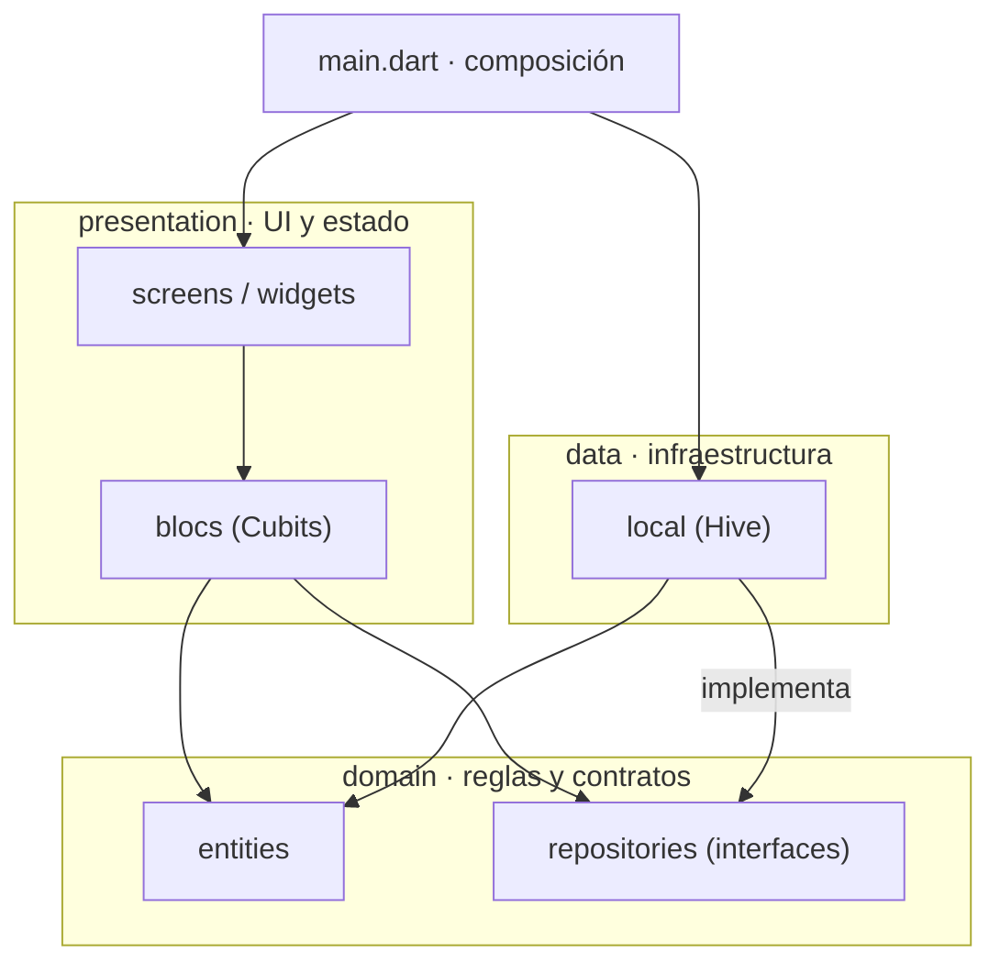

# Especificación técnica · ToddlerLogic

| | |
|---|---|
| **Versión de la app** | `0.0.1-beta+1` (línea base) |
| **Fecha de la línea base** | 2026-10-13 |
| **Estado** | Beta interna · solo Android · sin publicar |
| **Documentos relacionados** | [README.md](README.md) (visión de producto y alcance MVP) · [DOCUMENTATION.md](DOCUMENTATION.md) (detalle de persistencia Hive) · [BACKLOG.md](BACKLOG.md) (trabajo pendiente y refinamientos en `docs/hu/`) |

Este documento fija **cómo se construye** ToddlerLogic: arquitectura, buenas prácticas, criterios de calidad y las decisiones tomadas hasta ahora. El **qué** (visión, módulos del MVP, reglas de negocio) vive en el README. Las palabras **DEBE**, **NO DEBE** y **DEBERÍA** indican reglas obligatorias, prohibiciones y recomendaciones fuertes.

**Cómo se mantiene:** cualquier PR que cambie la arquitectura, una regla de calidad o tome una decisión de las listadas en la sección 8 DEBE actualizar este documento en el mismo PR (nueva fila en el registro de decisiones o cambio de estado de una existente).

---

## 1. Línea base 0.0.1-beta: qué hay y qué no

La versión 0.0.1-beta congela el estado tras los PRs #1–#9 más las ramas `fix/board-layout-and-tests` y esta especificación.

| Área (README) | Estado en 0.0.1-beta |
|---|---|
| Módulo 1 · Memory Game | **Implementado parcialmente.** Dos niveles con emojis: «Animales de la Granja» (4 cartas) y «Selva Sorpresa» (6 cartas). Volteo animado, emparejamiento, diálogo de victoria, guardado del nivel completado. La temática Dinosaurios Premium y su candado se descartaron: el juego de memoria es 100 % gratuito (D-028). |
| Módulo 2 · Shadow Matching | No iniciado. |
| Módulo 3 · Clasificación por tamaño | No iniciado. |
| Módulo 4 · Zona de Padres (Gatekeeper) | Solo un botón que muestra «Próximamente». |
| Premium (`is_premium`) y restauración | El campo existe en `UserProfile` y se persiste, pero la UI no lo lee. Sin Google Play Billing. |
| Ajustes (sonido, dificultad) | `isSoundEnabled` se persiste; la app no tiene audio ni pantalla de ajustes. |
| Progreso del niño | `LevelState` se guarda al ganar, pero no se muestra en ninguna pantalla. |
| UX de error amigable | Cumplido en Memory Game: sin penalizaciones ni sonidos; las cartas vuelven boca abajo tras 1,2 s. |
| Privacidad (0 permisos, sin telemetría) | Cumplido (ver 1.1). |
| Tamaño < 50 MB | Cumplido (ver 1.1). |
| Orientación | Vertical y horizontal, verificado en un moto g55 5G (Android 16). |

### 1.1 Métricas medidas en la línea base

| Métrica | Valor | Cómo se mide |
|---|---|---|
| Tests | 48 en 11 archivos, todos pasan | `flutter test` |
| Cobertura de líneas | 97,4 % (sin `*.g.dart` ni `lib/main.dart`) | sección 6.3 |
| Análisis estático | 0 incidencias | `flutter analyze` |
| APK release universal | 44,6 MB (3 ABIs; por ABI en Play será bastante menor) | `flutter build apk --release` |
| Permisos en el APK release | Ninguno visible para el usuario. Solo `DYNAMIC_RECEIVER_NOT_EXPORTED_PERMISSION`, interno y de firma, que añade AndroidX | `aapt2 dump permissions` |
| Dependencias de red o analítica | Ninguna | `pubspec.yaml` |

---

## 2. Stack tecnológico

| Componente | Versión fijada | Rol |
|---|---|---|
| Flutter / Dart | 3.47.5 stable / 3.13.4 (restricción `sdk: '>=3.3.0 <4.0.0'`) | Framework y lenguaje |
| `bloc` / `flutter_bloc` | 9.2.1 / 9.1.1 | Gestión de estado con Cubit |
| `hive_ce` / `hive_ce_generator` | 2.22.0 / 1.12.0 (con `build_runner` 2.16.2) | Persistencia local y generación de adapters (D-014) |
| `path_provider` | 2.1.6 | Ruta del directorio de documentos de la app |
| `flutter_localizations` / `intl` | SDK / 0.20.3 | Catálogo de textos (`gen-l10n`, archivos ARB) y plurales (D-027) |
| `mocktail` | 1.0.5 | Mocks en tests |
| `flutter_lints` | 6.0.0 | Reglas de análisis estático |
| Android | `applicationId` `com.zerofriction.toddler_logic` · **minSdk 26 (Android 8.0 Oreo)** · target/compile SDK 36 · Kotlin DSL · JVM 17 | Única plataforma generada |

Las versiones exactas están en `pubspec.lock`, que se versiona (D-008).

---

## 3. Arquitectura

### 3.1 Capas y regla de dependencias

Clean Architecture en tres capas. Las dependencias **solo apuntan hacia el dominio**.



| Capa | Puede importar | NO DEBE importar |
|---|---|---|
| `domain` | Solo Dart puro (D-012; lo comprueba `test/architecture/domain_purity_test.dart`) | `flutter`, `hive_ce` y cualquier paquete de infraestructura, `data`, `presentation` |
| `data` | `domain`, Hive, `path_provider` | `presentation`, `flutter/material` |
| `presentation` | `domain`, `flutter`, `bloc` | `data` (accede a la persistencia solo por `IPersistenceRepository`) |
| `main.dart` | Todo | Contener lógica de UI o de negocio: solo compone e inicia la app |

### 3.2 Estructura de carpetas

```
lib/
├── main.dart                          # Arranque: Hive → repositorio → idioma → ToddlerLogicApp
├── l10n/                              # Catálogo de textos: app_<idioma>.arb (el .dart se genera; no se versiona)
├── data/local/                        # HivePersistenceConfig, HivePersistenceRepository
│   └── models/                        # Modelos de guardado Hive (+ *.g.dart generados) con fromEntity/toEntity
├── domain/
│   ├── entities/                      # LevelState, UserProfile, AppLanguage (Dart puro)
│   ├── memory/                        # Reglas del juego de memoria: escalera, estrellas, temáticas (Dart puro)
│   ├── parental/                      # Control para adultos de la Zona de Padres: ParentalGate (Dart puro, HU-004)
│   └── repositories/                  # IPersistenceRepository
└── presentation/
    ├── blocs/<feature>/               # <feature>_cubit, _state, modelos de UI
    ├── l10n/                          # Idioma de arranque (resolveStartupLocale)
    ├── screens/                       # Una pantalla por archivo
    └── widgets/                       # Widgets reutilizables de una o más pantallas
test/                                  # Refleja la estructura de lib/ (sección 6.1)
tool/                                  # Scripts de desarrollo (coverage_check.dart)
```

Cada módulo nuevo (Shadow Matching, Clasificación, Zona de Padres) DEBE seguir la misma forma: `presentation/blocs/<modulo>/`, `presentation/screens/<modulo>_screen.dart` y, si necesita reglas propias, entidades e interfaces en `domain`. La Zona de Padres es un contexto independiente: los juegos NO DEBEN conocer las restricciones parentales; la capa de UI decide el acceso (README, «Segregación de Dominios»).

### 3.3 Arranque y composición

1. `WidgetsFlutterBinding.ensureInitialized()`.
2. `getApplicationDocumentsDirectory()` da la ruta de Hive.
3. `HivePersistenceConfig.initialize()` registra los adapters y abre las cajas. Es idempotente y segura ante llamadas concurrentes (detalle en DOCUMENTATION.md).
4. Se crea `HivePersistenceRepository` y se inyecta con `RepositoryProvider<IPersistenceRepository>` en la raíz de `ToddlerLogicApp`.
5. Cada pantalla crea su Cubit con `BlocProvider` leyendo el repositorio del contexto.

### 3.4 Persistencia

| Caja Hive | Modelo de guardado → entidad | Clave | typeId |
|---|---|---|---|
| `level_states` | `LevelStateHiveModel` → `LevelState` | `levelId` | 0 |
| `user_profile` | `UserProfileHiveModel` → `UserProfile` | `current_user_profile` | 1 |
| `memory_progress` | `MemoryProgressHiveModel` → `MemoryProgress` | `current_memory_progress` | 2 |

- Las cajas guardan **modelos de guardado** (`data/local/models/`), nunca entidades de dominio. El repositorio convierte con `fromEntity`/`toEntity`; las reglas de negocio (por ejemplo, estrellas entre 0 y 3) las valida la entidad al convertir.
- `test/data/local/hive_v2_compatibility_test.dart` y los fixtures de `test/fixtures/hive_v2/` garantizan que el formato en disco no cambia. Si cambia, el test falla.

- Campos de `UserProfileHiveModel`: 0 `isPremium`, 1 `isSoundEnabled`, 2 `languageCode` (opcional, HU-011; los perfiles anteriores lo leen como `null`). El próximo índice libre es 3.
- Campos de `MemoryProgressHiveModel` (HU-001): 0 `currentLevel`, 1 `hasBadge`, 2 `bestStarsByLevel` (nivel → estrellas), 3 `achievedAtByLevel` (nivel → fecha), 4 `lastPlayedAt`. El próximo índice libre es 5.
- Los `typeId` y los índices `@HiveField` **NO DEBEN reutilizarse ni cambiar de significado**, porque romperían los datos ya guardados en los dispositivos. Un campo eliminado deja su índice reservado. El próximo `typeId` libre es **3**. `LevelState` (typeId 0) dejará de usarse cuando el juego pase a `MemoryProgress` (HU-001, entrega 3); su typeId queda reservado.
- Identificadores de nivel en uso: `farm_easy`, `wild_medium`. Un `levelId` ya publicado NO DEBE renombrarse.

### 3.5 Estado (Cubit)

- Un Cubit por pantalla o feature; recibe sus dependencias por constructor y como interfaces.
- El estado es inmutable: campos `final`, `copyWith`, igualdad por valor. Una lista ya emitida NO DEBE mutarse (crea una copia antes de modificarla).
- Toda operación asíncrona que vuelva a emitir DEBE comprobar `isClosed` después de cada `await`.
- Los errores de infraestructura se reportan con `addError` (llegan a `onError` / `BlocObserver`) y **nunca interrumpen la experiencia del niño** (D-010).

---

## 4. Buenas prácticas

### 4.1 Código

- Las reglas de `flutter_lints` aplican; `flutter analyze` DEBE terminar con 0 incidencias.
- Nombres de código en inglés; comentarios y documentación en español (convención actual del repo).
- **Ningún texto visible se escribe en el código:** todos salen del catálogo (`AppLocalizations.of(context)`), incluidas las etiquetas de accesibilidad. Un texto nuevo se añade primero a `lib/l10n/app_en.arb` con su `@descripción` para los traductores, y después a los otros 8 idiomas. Lo comprueban `test/architecture/no_hardcoded_texts_test.dart` y `test/l10n/arb_parity_test.dart` (D-027).
- **RTL (árabe):** se usan APIs direccionales (`EdgeInsetsDirectional`, `AlignmentDirectional`, `PositionedDirectional`, `TextAlign.start`/`end`); nunca `left`/`right` para elementos con sentido de lectura. Los iconos con dirección se invierten en RTL (D-027).
- Widgets y Cubits con una sola responsabilidad. Una pantalla que pase de unas 250 líneas DEBERÍA dividirse en widgets privados o en `widgets/`.
- Los widgets que los tests buscan llevan `ValueKey` estables (por ejemplo `memory-card-$index`). Cambiar una key implica actualizar los tests en el mismo PR.
- Los archivos se guardan en UTF-8 **sin BOM**.

### 4.2 Experiencia infantil (requisitos de UI)

- Sin penalizaciones, contadores negativos ni sonidos estridentes ante un error; la corrección es suave y animada.
- Ningún tablero de juego DEBE requerir scroll ni recortar elementos, en vertical u horizontal, en pantallas desde 914 × 411 dp (D-011, D-013).
- Las zonas táctiles DEBERÍAN ser grandes: las cartas actuales ocupan toda su celda de la cuadrícula.
- Los elementos interactivos llevan `Semantics` con una etiqueta en español (ver `MemoryCardWidget`).
- Las acciones de adulto (compras, ajustes, enlaces externos, peticiones de permiso) DEBEN quedar tras el control para adultos (D-029, desde HU-004).
- Toda pantalla de adultos DEBE envolverse en `AdultSessionGuard`: vuelve al menú tras 1 minuto sin toques, en segundo plano o con la pantalla apagada (HU-004 R7).
- Dentro de un juego NO DEBE haber botones que saquen al niño de él: las transiciones tras ganar o perder son automáticas (D-022, desde HU-001).
- Toda pantalla DEBE proteger el «atrás» del sistema pidiendo repetir el gesto, con un aviso pequeño y sin botones (D-025, desde HU-001).
- El tiempo, si existe, se muestra sin números, sin rojo y sin sonidos (D-021).

### 4.3 Privacidad y seguridad

- NO DEBEN añadirse dependencias de analítica, publicidad, crash reporting remoto ni acceso a red sin una decisión explícita registrada en la sección 8.
- Todo permiso nuevo en el APK release DEBE justificarse en la sección 8. Excepción prevista: `com.android.vending.BILLING` cuando se integre Google Play Billing (D-017).
- No se guardan datos personales del niño: solo progreso de niveles y preferencias.

### 4.4 Dependencias

- Cada dependencia nueva DEBE justificarse en el PR (qué resuelve, si se mantiene activamente y cuánto aumenta el tamaño del APK).
- Se prefiere el SDK de Flutter y Dart a un paquete externo, y los emojis o assets vectoriales a imágenes rasterizadas.

---

## 5. Flujo de trabajo

- **Ramas:** `main` contiene solo versiones publicables; `develop` es la rama de integración. El trabajo se hace en `feature/*`, `fix/*` o `docs/*` creadas desde `develop`, y se integra por PR hacia `develop`. Las versiones pasan de `develop` a `main` por PR.
- **Commits:** prefijos de Conventional Commits (`feat:`, `fix:`, `docs:`, `test:`, `refactor:`, `chore:`).
- **Versionado:** SemVer con sufijo de pre-release en `pubspec.yaml` (`MAJOR.MINOR.PATCH-beta+BUILD`). El número `+BUILD` es el `versionCode` de Android y DEBE subir en cada build que se distribuya.
- **Corrección de fallos:** primero un test que reproduzca el fallo y falle; después la corrección.
- **Checklist de calidad.** El CI (`.github/workflows/ci.yml`, D-016) la ejecuta en cada PR hacia `develop` o `main` y en cada push a esas ramas; el check se llama `CI / quality`. Conviene ejecutarla también en local antes de abrir el PR:

```powershell
flutter pub get
dart run build_runner build
flutter analyze                          # 0 incidencias
flutter test --coverage                  # todos pasan
dart run tool/coverage_check.dart        # umbrales de la sección 6.3
```

Un cambio de UI DEBERÍA probarse además en un dispositivo real o en un emulador, en las dos orientaciones.

---

## 6. Testing y cobertura

### 6.1 Tipos de test y ubicación

| Tipo | Qué cubre | Herramientas | Ejemplo |
|---|---|---|---|
| Unitario | Entidades, modelos, Cubits | `flutter_test`, `mocktail` | `memory_game_cubit_test.dart` |
| Widget | Pantallas y widgets, navegación, diálogos | `testWidgets`, `MockPersistenceRepository` | `memory_game_screen_test.dart` |
| Integración local | Hive real en un directorio temporal | `dart:io`, Hive | `hive_persistence_config_test.dart` |
| Layout | Sin overflow ni recortes en tamaños de teléfono, en ambas orientaciones y en los 9 idiomas (incluido árabe en RTL) | `tester.view.physicalSize`, `FakeViewPadding`, `lookupAppLocalizations` | `responsive_layout_test.dart` |

- `test/` refleja la estructura de `lib/` (`lib/x/y.dart` se prueba en `test/x/y_test.dart`).
- Los mocks y stubs compartidos viven en `test/presentation/memory_game_test_support.dart`.
- Cada pantalla de juego nueva DEBE tener tests de layout en vertical y horizontal con al menos los dos tamaños de referencia (1129 × 508 dp y 914 × 411 dp), en **todos los idiomas** del catálogo.
- Los tests que buscan textos fijan el idioma explícitamente (`test/presentation/l10n_test_support.dart`, español por defecto).

### 6.2 Qué se espera probar

- Cada regla de negocio del Cubit: caminos de éxito, error y casos límite (índices fuera de rango, toques durante el procesamiento).
- `copyWith`, igualdad y validaciones de cada entidad o modelo.
- Los fallos de persistencia: la UI sigue funcionando y el error se reporta.

### 6.3 Cobertura mínima exigida

| Regla | Umbral |
|---|---|
| Cobertura total de líneas | **≥ 90 %** |
| Cobertura por archivo | **≥ 80 %** |
| Archivos nuevos o modificados en un PR | DEBERÍAN alcanzar ≥ 90 % |
| Excluidos del cálculo | Código generado (`*.g.dart` y `lib/l10n/app_localizations*.dart`) y `lib/main.dart` (arranque dependiente de la plataforma; se verifica al ejecutar la app) |

El script `tool/coverage_check.dart` aplica estos umbrales sobre `coverage/lcov.info` y termina con código de salida 1 si no se cumplen. La medida es de **líneas**: subir un umbral exige actualizar el script y esta tabla en el mismo PR.

---

## 7. Configuración del entorno de desarrollo

Verificado en Windows 11 con Flutter 3.47.5 en el PATH, Android Studio, el Android SDK 36 con cmdline-tools y licencias aceptadas, y VS Code con las extensiones Dart y Flutter. Pasos de instalación en el README. Particularidades conocidas:

- El emulador `Medium_Phone_API_37.0` puede mostrar la app en negro tras arrancar desde un snapshot con el sistema sobrecargado. Solución: arranque en frío (`-no-snapshot-load` o *Cold Boot Now* en Android Studio).
- En PowerShell 5.1, `Set-Content -Encoding utf8` añade BOM y `Get-Content -Raw` corrompe las tildes. Edita los archivos con el IDE o con herramientas que respeten UTF-8.

---

## 8. Registro de decisiones

| ID | Decisión | Motivo | Estado |
|---|---|---|---|
| D-001 | Flutter, con Android como primera plataforma | Un solo código base, rendimiento nativo; iOS se podrá añadir más adelante | Vigente |
| D-002 | Cubit (`flutter_bloc`) para el estado | Flujo unidireccional y fácil de testear, sin la ceremonia de los eventos de Bloc | Vigente |
| D-003 | Persistencia local con Hive; sin backend | Local-first, funciona sin conexión, coste de infraestructura cero | Vigente |
| D-004 | Emojis como contenido de las cartas | Cero assets: menor tamaño y sin licencias de imágenes | Vigente (revisable para temáticas premium) |
| D-005 | Material 3 con color semilla pastel `#98FFD9` | Estética calmada y coherente para niños | Vigente |
| D-006 | `applicationId` `com.zerofriction.toddler_logic` | Es permanente una vez publicada la app en Google Play | Vigente · **no cambiar tras publicar** |
| D-007 | `flutter_lints` 6 como base de análisis | Estándar recomendado para apps Flutter | Vigente |
| D-008 | Se versiona `pubspec.lock`; no se versionan `*.g.dart` | Compilaciones reproducibles; el código generado se regenera con `build_runner` | Vigente |
| D-009 | Siempre 3 estrellas al completar un nivel | A los 3 años se celebra el logro, no la eficiencia | **Sustituida por D-030** (estrellas según los movimientos) |
| D-010 | Los errores de persistencia se reportan con `addError` y no se muestran al niño | La victoria nunca debe interrumpirse por un fallo técnico | Vigente |
| D-011 | El tablero elige el número de columnas que da las cartas más grandes, solo con filas completas | Evita tableros 3+1 y cartas recortadas en cualquier orientación | Vigente · con HU-001 debe admitir hasta 16 cartas |
| D-012 | El dominio es Dart puro; la persistencia usa modelos de guardado propios en `data/local/models/` con los mismos typeIds e índices de campo | Cumple la arquitectura del README y desacopla el formato en disco de las reglas de negocio | Vigente desde TD-004 (antes: deuda aceptada) |
| D-013 | Se soportan vertical y horizontal | Los niños giran el teléfono; bloquear la orientación es peor experiencia | Vigente |
| D-014 | Persistencia con `hive_ce` (continuación mantenida de Hive v2), conservando `@HiveType`/`@HiveField` y los typeIds | Hive 2.2.3 no se publica desde 2022 y su generador fijaba `analyzer` 6.4.1; `hive_ce` usa `analyzer` 14, corrige la fuga de errores de `openBox` y lee los datos de Hive 2.2.3 (test con fixtures en `test/fixtures/hive_v2/`) | Vigente desde TD-002. El estilo `@GenerateAdapters` de `hive_ce` se evaluará con TD-004 |
| D-015 | Interfaz solo en español, con los textos en el código | Mercado inicial hispanohablante | **Sustituida por D-027** (HU-011) |
| D-016 | La checklist de calidad de la sección 5 se ejecuta en GitHub Actions (`CI / quality`) con la misma versión de Flutter que en local; GitHub bloquea la fusión si falla | Las reglas de calidad no dependen de la disciplina manual (TD-001) | Vigente desde TD-001 · el bloqueo de fusión requiere activar la protección de ramas en GitHub |
| D-017 | La monetización usará Google Play Billing (pago único) | Lo exige Google Play para contenido digital; añadirá el permiso `BILLING` | Planificada |
| D-018 | Cobertura mínima de líneas: 90 % total y 80 % por archivo (sección 6.3) | Equilibra seguridad y velocidad; la línea base está en 97,4 % | Vigente |
| D-019 | El APK release se firma con la clave de debug | Plantilla por defecto de Flutter | **Pendiente**: configurar una keystore de release (`key.properties`, fuera de git) antes de distribuir |
| D-020 | El juego de memoria es un único modo progresivo: escalera 2×2 → 2×3 → 2×4 → 3×4 → 4×4 y límites sin tiempo → 90 → 60 → 45 → 30 s. Al perder se baja un nivel conservando el límite. Insignia dorada al superar el 4×4; después se vuelve al 2×2 sin tiempo | Progreso adaptado al ritmo del niño, con un reto final alcanzable (análisis de viabilidad en HU-001) | Aprobada · se implementa en HU-001 |
| D-021 | El tiempo se muestra como una barra que se vacía: sin números, sin rojo, sin sonidos. Perder se comunica como ayuda («Probemos con menos cartas») | Introduce un cronómetro sin contradecir «sin mecánicas frenéticas ni penalizaciones» del README | Aprobada · se implementa en HU-001 |
| D-022 | Dentro de un juego no hay botones que saquen al niño: tras ganar o perder, la app avanza sola con una transición suave. Se sale con «atrás» del sistema, protegido por D-025 | Los niños tocan botones sin intención, salen del juego y necesitan a un adulto para volver | Aprobada · aplica a todos los juegos desde HU-001 |
| D-023 | Cada juego superado por completo se muestra en dorado en el menú, de forma permanente | Recompensa visible y extensible a los juegos futuros | Ajustada por D-030: el dorado es **progresivo** según las estrellas (HU-002); la insignia de superar el juego se muestra como medalla (HU-001) |
| D-024 | El contenido de cada tablero es una temática elegida al azar, con emojis de la versión **Emoji 5.0 o anterior** | Variedad sin assets; con `minSdk` 26 (D-026), Emoji 5.0 es lo máximo que se ve en todos los dispositivos | Aprobada · se implementa en HU-001 |
| D-025 | **Salida protegida:** todo «atrás» del sistema pide repetir el gesto en 2 s, con un aviso pequeño sin botones ni pantalla completa. La única salida directa es el botón «Salir» del menú. Los gestos de inicio y recientes no se pueden interceptar (limitación de Android) | Evita salidas accidentales sin añadir botones que el niño pueda tocar | Aprobada · aplica a toda la app desde HU-001 |
| D-026 | Versión mínima de Android: **8.0 Oreo (API 26)**, fijada explícitamente en `android/app/build.gradle.kts` y no heredada de Flutter | Garantiza Emoji 5.0 (incluye 🦕 🦖 para la temática Dinosaurios) y mantiene la compatibilidad con dispositivos antiguos. Todo emoji de la app, incluida la UI fuera de los juegos, DEBE ser de Emoji 5.0 o anterior | Vigente desde 2026-10-18 · La mascota 🧸 (Emoji 11.0) y los iconos de los juegos se retiraron en TD-006; la identidad visual se define en HU-013 |
| D-027 | **Multiidioma:** 9 idiomas (inglés de EE. UU. por defecto y plantilla, español neutro, portugués de Brasil, alemán, japonés, francés, italiano, coreano y árabe RTL) desde un catálogo ARB con `gen-l10n`. El idioma se toma del teléfono en el primer arranque y se guarda en `UserProfile.languageCode`; después manda el guardado. La marca «ToddlerLogic» no se traduce | Llegar a varios mercados sin textos en el código; el idioma del niño no cambia por sorpresa | Vigente desde HU-011. Traducciones en borrador hasta su revisión externa (`docs/i18n/REVISION.md`); cambiarlo será una opción de la Zona de Padres (HU-012) |
| D-028 | **Modelo de acceso por juego:** el juego de memoria es **100 % gratuito**, sin candados ni contenido Premium, y sirve de muestra completa del contenido y la funcionalidad de la app. Los juegos siguientes combinan niveles gratis y niveles Premium, o son 100 % Premium; el modelo de cada uno se decide al refinarlo | Las familias prueban todo lo que ofrece la app antes de pagar (freemium ético del README) | Vigente desde 2026-10-20. Descarta HU-002 y HU-003 |
| D-029 | **Control para adultos (parental gate):** se entra con doble toque (aviso pequeño, 2 s, como D-025) y se supera una multiplicación escrita en palabras (factores del 3 al 9) respondida con un teclado numérico propio con las cifras en orden aleatorio. Al fallar: mensaje con los intentos que quedan, «Reintentar», «X» y «Volver al menú», y vuelta automática al menú a los 5 s, sin esperas ni bloqueos. Mínima exposición: se cierra al salir, al apagar la pantalla, en segundo plano o tras 1 minuto sin acciones. Toda compra, enlace externo o petición de permiso pasa por este control | Imposible de superar por azar para un niño de 3 años y válido para Apple (ejemplo de tarea matemática) | Vigente desde HU-004 (2026-10-26) |
| D-030 | **Estrellas y dorado:** cada nivel da 3★ si se gana en como mucho mínimo + número de nivel movimientos, 2★ hasta el doble del mínimo, 1★ hasta el triple, y ninguna por encima. Cada nivel guarda su mejor resultado. El icono del juego se vuelve dorado en proporción a las estrellas (mejor de cada nivel ÷ niveles × 3); 100 % = 3★ en todos los niveles. La celebración es igual de alegre con cualquier número de estrellas. La insignia por superar el último nivel es un logro aparte | Progreso visible y exigente pero alcanzable (simulación en HU-002) | Aprobada · estrellas en HU-001, icono dorado en HU-002. Sustituye a D-009 y ajusta D-023 |
| D-031 | **Los logros se mantienen con la práctica:** tras 7 días sin jugar a un juego, sus estrellas se van perdiendo una a una cada 3 días, empezando por la más antigua, hasta quedar sin dorado. Se recuperan volviendo a ganar los niveles. La insignia no se pierde. Sin mensajes negativos | Control de progreso y refuerzo de las habilidades (decisión del product owner) | Aprobada · se implementa en HU-002. Riesgo aceptado: va contra la idea de «sin penalizaciones» y se parece a las «rachas» que el borrador del código infantil del ICO desaconsejaba. Los padres podrán desactivarla (HU-016) |

---

## 9. Deuda técnica y riesgos conocidos

| Tema | Impacto | Acción propuesta |
|---|---|---|
| `hive_ce_generator` admite `analyzer` < 14.5.0 | Al actualizar Flutter o Dart, `pub` podría no encontrar una combinación compatible | Revisarlo en el mismo PR que actualice Flutter (local y CI) |
| `isPremium` se guarda pero no se lee | El candado Premium aún no existe | Implementar con HU-006 y los juegos 2 y 3 (HU-007, HU-008); nunca en el juego de memoria (D-028) |
| Versión de Flutter fijada en dos sitios (local y `ci.yml`) | Si solo se actualiza una, los resultados de local y del CI pueden diferir | Actualizarlas en el mismo PR (TD-001, C2) |
| Firma release con la clave de debug | No se puede publicar en Google Play | Keystore de release (D-019) |
| Sin carpeta `ios/` | No hay build para iOS | Ejecutar `flutter create --platforms=ios .` cuando se decida |

---

## 10. Próximos hitos hacia el MVP

Orden propuesto, sujeto a revisión:

1. **Cierre de la beta técnica:** CI, migración a `hive_ce` y keystore de release.
2. **Juego de memoria completo y 100 % gratuito (D-028):** HU-001.
3. **Zona de Padres (Gatekeeper):** desafío para adultos, ajustes de sonido y dificultad.
4. **Google Play Billing:** pago único y restauración de la compra.
5. **Módulos 2 y 3:** Shadow Matching y Clasificación por tamaño.
