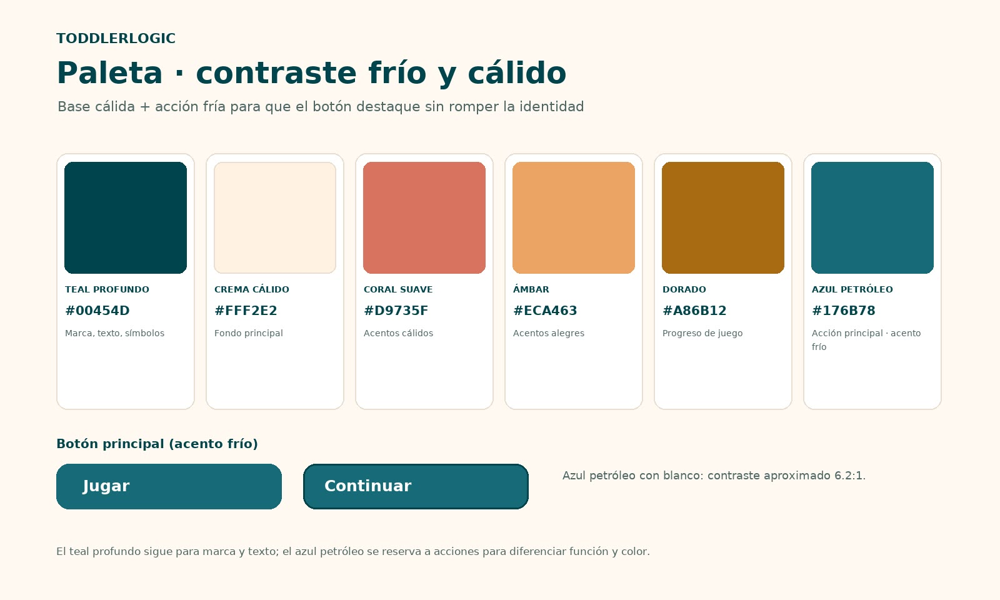

# Paleta de colores · ToddlerLogic

Fuente de verdad de los colores de la app (decisión **D-032**, 2026-10-27). La referencia visual es [paleta-colores.jpg](paleta-colores.jpg).

> **Regla:** la app solo usa los 7 colores de esta tabla, y sus transparencias. Ningún desarrollador ni ninguna historia nueva DEBE añadir otro color. Si una necesidad no cabe en la paleta, se propone un cambio de **esta** paleta en su propio PR, con la decisión registrada en la sección 8 de la especificación.

## Colores

**Base cálida + acción fría:** el fondo y los acentos son cálidos; el azul petróleo se reserva para las acciones, para que el botón destaque sin romper la identidad.

| Nombre | Hex | Nombre en código | Uso |
|---|---|---|---|
| Teal profundo | `#00454D` | `AppPalette.deepTeal` | Marca, texto y símbolos (iconos) |
| Crema cálido | `#FFF2E2` | `AppPalette.warmCream` | Fondo principal |
| Coral suave | `#D9735F` | `AppPalette.softCoral` | Acentos cálidos (decorativo) |
| Ámbar | `#ECA463` | `AppPalette.amber` | Acentos alegres (decorativo, celebraciones) |
| Dorado | `#A86B12` | `AppPalette.gold` | Progreso de juego: estrellas, insignia, dorado progresivo del icono (HU-002) |
| Azul petróleo | `#176B78` | `AppPalette.petrolBlue` | Acción principal y acento frío: botones, elementos interactivos, foco |
| Blanco | `#FFFFFF` | `AppPalette.white` | Texto sobre el azul petróleo y superficies de tarjetas (como en la referencia) |

El teal profundo sigue para marca y texto; el azul petróleo se reserva a acciones, para diferenciar función y color.

## Contraste (WCAG 2.1)

Calculado el 2026-10-27. **Texto normal** exige 4,5:1 (AA); **texto grande** (≥ 18 pt, o ≥ 14 pt en negrita) y **elementos no textuales** (iconos, bordes, barras) exigen 3:1.

| Texto o elemento | Sobre crema | Sobre blanco | Sobre azul petróleo | Sobre teal profundo |
|---|---|---|---|---|
| Teal profundo | ✅ 9,73 | ✅ 10,72 | ❌ 1,74 | — |
| Azul petróleo | ✅ 5,59 | ✅ 6,16 | — | ❌ 1,74 |
| Blanco | ❌ 1,10 | — | ✅ 6,16 | ✅ 10,72 |
| Crema cálido | — | ❌ 1,10 | ✅ 5,59 | ✅ 9,73 |
| Dorado | ⚠️ 3,99 (solo grande o no textual) | ⚠️ 4,40 (solo grande o no textual) | ❌ 1,40 | ❌ 2,44 |
| Ámbar | ❌ 1,89 | ❌ 2,09 | ❌ 2,95 | ✅ 5,14 |
| Coral suave | ❌ 2,90 | ❌ 3,20 | ❌ 1,93 | ⚠️ 3,35 (solo grande o no textual) |

## Reglas de uso

| # | Regla |
|---|---|
| C1 | **Solo estos 7 colores.** Nada de `Colors.*` de Material (salvo `Colors.transparent`), ni literales `Color(0x…)`, ni `ColorScheme.fromSeed` (genera tonos que no están en la paleta). Todo color sale de `AppPalette` (TD-009). |
| C2 | **Variantes permitidas:** solo la **transparencia** de un color de la paleta (`AppPalette.deepTeal.withValues(alpha: 0.1)`), por ejemplo para sombras, velos, estados desactivados o pulsados. No se aclaran ni oscurecen tonos. |
| C3 | **Texto** solo en las combinaciones ✅ de la tabla de contraste. El texto normal va en teal profundo o azul petróleo sobre crema o blanco, o en blanco o crema sobre azul petróleo o teal profundo. |
| C4 | **Coral y ámbar son decorativos:** nunca para texto ni para transmitir información importante por sí solos (salvo ámbar sobre teal profundo). |
| C5 | **Dorado** para el progreso: estrellas, insignia, barra o llenado. Como texto, solo grande. |
| C6 | **Azul petróleo** solo para lo que se toca o se activa (botones, interruptores, selección, foco). Así el niño y el adulto aprenden que «azul = se puede tocar». |
| C7 | **Sin rojo de error** (SPECIFICATION 4.2): la paleta no tiene color de error a propósito. Un fallo se comunica con calma, sin cambiar a otro color. |
| C8 | **Excepciones:** los **emojis** del contenido de las cartas (son glifos del sistema con sus propios colores) y lo que dibuja el sistema (barra de estado, icono monocromo temático de Android 13, que el sistema tiñe). |

## Asignación por elemento (aplicada en TD-009)

| Elemento | Color |
|---|---|
| Fondo de las pantallas | Crema cálido |
| Tarjetas, cabecera y pie del juego, celebraciones | Blanco |
| Títulos y texto | Teal profundo |
| Botones principales (botón «Memoria» del menú, «Aceptar» del desafío) | Azul petróleo con texto blanco |
| Botones secundarios (texto), botón tonal «Volver al menú», teclas de números | Azul petróleo sobre blanco o crema (las teclas, blancas con borde azul petróleo) |
| Reverso de las cartas | Azul petróleo (con el símbolo «?» en crema) |
| Cartas boca arriba y parejas encontradas | Blanco con borde ámbar |
| Barra de tiempo, contador de movimientos | Teal profundo (no se tocan, C6); la barra, sobre teal profundo al 15 % (tranquila, D-021) |
| Estrellas, insignia, dorado progresivo, puntos de nivel alcanzados | Dorado (pendientes: dorado al 20 % o 50 %) |
| Medalla de la insignia en el botón «Memoria» | Dorado sobre un círculo blanco (sobre azul petróleo no contrasta) |
| Celebración | Tarjeta blanca con borde ámbar y trofeo coral; con la insignia, borde y medalla dorados; título en teal profundo |
| Aviso «se acabó el tiempo» | Tarjeta blanca, reloj de arena y texto en teal profundo |
| Marcador del icono del juego (hasta HU-013) | Teal profundo sobre un círculo ámbar (5,14:1) |
| Avisos pequeños (`QuietHint`) | Teal profundo al 90 % con texto blanco |
| Sombras y velos | Teal profundo con transparencia |

## Cómo se garantiza

- `lib/presentation/theme/app_palette.dart` define los 7 colores (es el único archivo con literales) y `app_theme.dart` el tema (`ColorScheme` construido color a color, sin `fromSeed`) (TD-009).
- `test/architecture/palette_test.dart` hace fallar el CI si en `lib/` aparece un color fuera de `AppPalette` (literales `Color(0x…)`, `Colors.*` salvo `transparent`, `fromSeed`) y comprueba que los valores de `AppPalette` son exactamente los de esta tabla y que las combinaciones de texto del tema cumplen el contraste (TD-009).
- La **definición de «Lista»** del backlog exige que cada historia con interfaz indique qué colores de la paleta usa.
