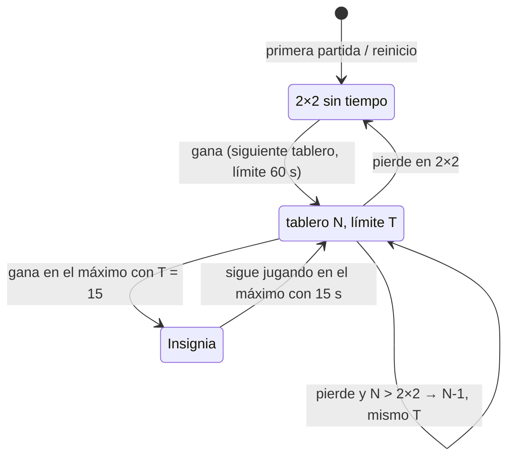

# HU-001 · Memoria progresiva con tiempo e insignia dorada

| | |
|---|---|
| **Estado** | En refinamiento: hay preguntas abiertas que bloquean (sección 8) |
| **Épica** | E1 · Juego de memoria |
| **Prioridad** | P1 |
| **Tamaño** | L (estimado; se confirma al cerrar las preguntas) |
| **Fecha de refinamiento** | 2026-10-16 |
| **Versión base** | 0.0.1-beta |

## 1. Historia

**Como** niño o niña que juega a la memoria (acompañado por un adulto),
**quiero** un único juego que añada cartas y reduzca el tiempo cuando gano, y que me ponga menos cartas cuando no lo logro,
**para** progresar a mi ritmo y conseguir una insignia dorada al dominarlo.

## 2. Petición original

> Una mejora en el juego actual de voltear cartas, cambiándolo a una única opción, donde al ganar en 2x2 avanza al siguiente nivel 2x3 y así a 3x3 hasta llegar al que sería el máximo posible en pantalla, y le adicionaría tiempo de 60 segundos. Al ganar disminuye el tiempo a 30 segundos y al perder devuelve la cantidad de cartas conservando el límite de tiempo hasta volver a 2x2 y reiniciar sin tiempo. Si logra ganar todos los niveles hasta el final con 15 segundos gana una insignia dorada y el icono queda dorado.

## 3. Situación actual

- El menú ofrece dos niveles independientes: «Animales de la Granja» (2×2, `farm_easy`) y «Selva Sorpresa» (2×3, `wild_medium`).
- No hay tiempo límite. Al ganar se guarda un `LevelState` con 3 estrellas y el diálogo solo ofrece «Volver al menú».
- Si dos cartas no coinciden, vuelven boca abajo a los 1,2 s. No hay derrota posible.

## 4. Comportamiento propuesto (interpretación, pendiente de confirmar)

### 4.1 Reglas

| # | Regla | Propuesta | Origen |
|---|---|---|---|
| R1 | El menú tiene **una sola opción de memoria**; desaparecen los dos niveles actuales | «Jugar a la memoria» | Petición |
| R2 | Escalera de tableros, de menor a mayor | 2×2 → 2×3 → 2×4 → 3×4 → 4×4 (4, 6, 8, 12 y 16 cartas) | Petición + **P1** (el 3×3 tiene un número impar de cartas) |
| R3 | El primer 2×2 se juega **sin tiempo** | Sin cronómetro visible | Petición |
| R4 | Al ganar se sube al siguiente tablero | Si se viene de jugar sin tiempo, el límite empieza en 60 s | Petición |
| R5 | Cada victoria cronometrada reduce el límite | 60 → 30 → 15 s; nunca baja de 15 s | Petición + **P2** (viabilidad) |
| R6 | Si se acaba el tiempo, se baja un tablero **conservando el límite de tiempo** | Ejemplo: se pierde en 3×4 con 15 s → 2×4 con 15 s | Petición |
| R7 | Perder en el 2×2 cronometrado reinicia la partida | 2×2 sin tiempo; la siguiente subida vuelve a empezar en 60 s | Petición |
| R8 | Ganar el tablero máximo con un límite mayor de 15 s | Se sigue en el máximo y el límite baja según R5 | Interpretación |
| R9 | **Insignia dorada:** ganar el tablero máximo con un límite de 15 s | Permanente; no se pierde aunque luego se pierda una partida | Petición + **P2** |
| R10 | «El icono queda dorado» | El botón de memoria del menú se vuelve dorado y muestra la insignia | Petición + **P4** |
| R11 | Momento en que arranca el cronómetro | Al tocar la primera carta, no al mostrar el tablero | **P5** |
| R12 | Pausas del cronómetro | Se pausa con la app en segundo plano y mientras se muestra un diálogo | Necesario para ser justo |
| R13 | Persistencia | El tablero actual, el límite y la insignia se guardan y se recuperan al reabrir la app | **P6** |
| R14 | Mensaje al perder | Amable y sin sonido negativo: «¡Se acabó el tiempo! Probemos con menos cartas» | Principios del README + **P3** |
| R15 | Avance tras ganar | El diálogo de victoria ofrece «¡Siguiente!» y «Volver al menú»; no avanza solo | **P7** |

### 4.2 Diagrama de estados

### 4.3 Ejemplo de partida (con los valores propuestos)

| Paso | Tablero | Límite | Resultado | Siguiente |
|---|---|---|---|---|
| 1 | 2×2 | sin tiempo | gana | 2×3 · 60 s |
| 2 | 2×3 | 60 s | gana | 2×4 · 30 s |
| 3 | 2×4 | 30 s | pierde | 2×3 · 30 s |
| 4 | 2×3 | 30 s | gana | 2×4 · 15 s |
| 5 | 2×4 | 15 s | gana | 3×4 · 15 s |
| … | 4×4 | 15 s | gana | 🏅 insignia dorada |

## 5. Análisis de viabilidad del tiempo (afecta a P2)

Estimación orientativa para **un adulto con memoria perfecta**. Supuestos: unas 1,6 jugadas por pareja de media (resultado conocido para la memoria con recuerdo perfecto), unos 0,5 s por toque y la espera actual de 1,2 s en cada fallo.

| Tablero | Parejas | Tiempo mínimo aproximado (adulto ideal) | ¿Cabe en 15 s? |
|---|---|---|---|
| 2×2 | 2 | ~5 s | Sí |
| 2×3 | 3 | ~7 s | Sí |
| 2×4 | 4 | ~9 s | Sí |
| 3×4 | 6 | ~14 s | Apenas |
| 4×4 | 8 | ~19 s | **No** |

Un niño de 3 años es varias veces más lento. **Con las reglas tal cual, la insignia es imposible** en un tablero de 4×4 e inalcanzable para el público objetivo a partir de 2×4. Por eso hay que recalibrar el tiempo o el tablero máximo (P2).

## 6. Conflictos con el producto actual

| Documento | Regla actual | Conflicto | Resolución propuesta |
|---|---|---|---|
| README, línea 3 | Critica las apps con «mecánicas frenéticas» | Una cuenta atrás que se acorta añade presión | P3: cronómetro visual suave (barra que se vacía, sin números rojos ni pitidos) y registrar la decisión como **D-020** |
| README, «UX del Error Amigable» | «No existen penalizaciones» | Perder por tiempo baja de nivel | P3: presentarlo como ayuda («menos cartas»), nunca como castigo; sin sonido negativo |
| SPECIFICATION D-009 | Siempre 3 estrellas | Con niveles y tiempo, las estrellas pierden sentido | Sustituir las estrellas por el indicador de tablero y la insignia; actualizar D-009 |
| SPECIFICATION 3.4 | Los `levelId` publicados no se renombran | `farm_easy` y `wild_medium` desaparecen | Sin impacto: la app no se ha publicado. `LevelState` puede retirarse (su typeId 0 queda reservado) |

## 7. Criterios de aceptación (borrador)

Se cerrarán cuando estén resueltas las preguntas de la sección 8.

1. **Dado** que abro la app por primera vez, **cuando** veo el menú, **entonces** hay una sola opción de memoria y no se muestran los niveles «Granja» ni «Selva».
2. **Dado** que empiezo una partida nueva, **cuando** se muestra el tablero, **entonces** es 2×2 y no hay cronómetro.
3. **Dado** que gano el 2×2 sin tiempo, **cuando** pulso «¡Siguiente!», **entonces** juego el 2×3 con un límite de 60 s.
4. **Dado** que gano un tablero cronometrado que no es el máximo, **entonces** el siguiente es un tablero mayor y el límite es la mitad, sin bajar de 15 s.
5. **Dado** que el tiempo llega a 0 en un tablero mayor que 2×2, **entonces** veo un mensaje amable, sin sonido negativo, y el siguiente tablero es el anterior con el mismo límite.
6. **Dado** que el tiempo llega a 0 en el 2×2 cronometrado, **entonces** la siguiente partida es 2×2 sin tiempo y la próxima subida empieza en 60 s.
7. **Dado** que gano el tablero máximo con un límite de 15 s, **entonces** recibo la insignia dorada, y el botón del menú se muestra dorado desde ese momento y tras reiniciar la app.
8. **Dado** que salgo de la app con el cronómetro en marcha, **cuando** vuelvo, **entonces** el cronómetro continúa desde donde estaba (no ha corrido en segundo plano).
9. **Dado** que cierro la app a mitad de la escalera, **cuando** la vuelvo a abrir, **entonces** la siguiente partida usa el mismo tablero y el mismo límite.
10. **Dado** cualquier tablero de la escalera, **entonces** se ve completo y sin overflow en vertical y en horizontal en los dos tamaños de referencia de la especificación (1129 × 508 y 914 × 411 dp).

## 8. Preguntas abiertas

| # | Pregunta | Recomendación | Bloquea |
|---|---|---|---|
| **P1** | El 3×3 tiene 9 cartas, un número impar, y no se puede emparejar. ¿Qué escalera usamos? | 2×2 → 2×3 → 2×4 → 3×4 → 4×4. Alternativa: 3×3 con una casilla central «estrella» que no se voltea | Sí |
| **P2** | Con 60 → 30 → 15 s la insignia es imposible (sección 5). ¿Cómo lo calibramos? | Tiempo proporcional a las parejas: 15 → 10 → 5 s por pareja, con el mínimo en 5 s/pareja (4×4 = 40 s). La insignia se gana superando el 4×4 con 5 s por pareja | Sí |
| **P3** | El cronómetro choca con «sin mecánicas frenéticas ni penalizaciones». ¿Lo aceptamos con estas suavizaciones? | Sí: barra visual suave, sin números en rojo ni sonido, mensaje de ayuda al perder; registrar D-020 | Sí |
| **P4** | «El icono queda dorado»: ¿el botón dentro de la app o el icono de la app en el teléfono? | El botón dentro de la app. Cambiar el icono del launcher en Android requiere alias de actividad y puede reiniciar el lanzador | Sí |
| **P5** | ¿El cronómetro arranca al mostrar el tablero o al tocar la primera carta? | Al tocar la primera carta | No (hay valor por defecto) |
| **P6** | ¿El progreso se conserva al cerrar la app? | Sí: tablero, límite e insignia | No (hay valor por defecto) |
| **P7** | Tras ganar, ¿avance automático o con botón? | Con botón «¡Siguiente!» | No (hay valor por defecto) |
| **P8** | ¿Qué emojis se usan? El 4×4 necesita 8 parejas | Mezclar los 12 actuales de granja y selva, al azar en cada partida | No (hay valor por defecto) |

## 9. Impacto técnico previsto

| Área | Cambio |
|---|---|
| Dominio | Nueva entidad `MemoryProgress` (tablero actual, límite de tiempo o ninguno, insignia) con **typeId 2**, y la escalera de tableros como reglas puras y testeables. Nuevos métodos en `IPersistenceRepository` |
| Datos | Una caja Hive nueva y su implementación en `HivePersistenceRepository`. Conviene hacer antes TD-002 (`hive_ce`) para no generar el adapter dos veces |
| Presentación | `MemoryGameCubit` gestiona el cronómetro (pausa, reanudación, derrota) y el resultado; `MainMenuScreen` pasa a una sola opción con estado dorado; `MemoryVictoryDialog` añade «¡Siguiente!»; nuevo diálogo de «se acabó el tiempo»; indicador de tablero y barra de tiempo en `MemoryGameScreen`. Traducir el encabezado «Memory Game» |
| Tests | Reglas de la escalera (unitarios, todas las transiciones de la sección 4.2); cronómetro con `fake_async`; persistencia con Hive real; layout de los 5 tableros en vertical y horizontal |
| Especificación | D-009 (estrellas), nueva D-020 (cronómetro), D-011 (tableros de hasta 16 cartas), registro de typeIds (2 en uso, 3 libre) |

## 10. Fuera de alcance

- Sonidos y música (HU-005).
- Temática Dinosaurios y contenido premium (HU-003).
- Mostrar un historial de partidas o estadísticas.
- Cambiar el icono de la app en el launcher (salvo que P4 lo pida).
