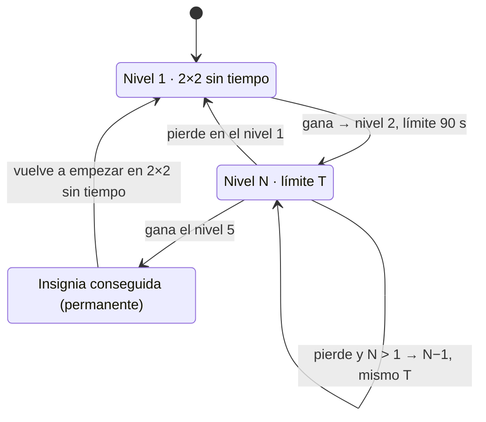

# HU-001 · Memoria progresiva con tiempo e insignia dorada

| | |
|---|---|
| **Estado** | Lista (refinamiento cerrado el 2026-10-16 y ajustado el 2026-10-17; el desarrollo **no** ha empezado) |
| **Épica** | E1 · Juego de memoria |
| **Prioridad** | P1 |
| **Tamaño** | L: unas 2 semanas, repartidas en 5 entregas (sección 10) |
| **Depende de** | TD-002 (migración a `hive_ce`), recomendado antes de la entrega 2 |
| **Versión base** | 0.0.1-beta |

## 1. Historia

**Como** niño o niña que juega a la memoria,
**quiero** un único juego que me ponga más cartas y menos tiempo cuando gano, y menos cartas cuando no lo logro,
**para** progresar a mi ritmo, sin quedarme atascado, hasta conseguir que el juego quede en dorado.

## 2. Petición original

> Una mejora en el juego actual de voltear cartas, cambiándolo a una única opción, donde al ganar en 2x2 avanza al siguiente nivel 2x3 y así a 3x3 hasta llegar al que sería el máximo posible en pantalla, y le adicionaría tiempo de 60 segundos. Al ganar disminuye el tiempo a 30 segundos y al perder devuelve la cantidad de cartas conservando el límite de tiempo hasta volver a 2x2 y reiniciar sin tiempo. Si logra ganar todos los niveles hasta el final con 15 segundos gana una insignia dorada y el icono queda dorado.

Las cifras de tableros y tiempos se ajustaron en el refinamiento (sección 9).

## 3. Situación actual

- El menú ofrece dos niveles independientes: «Animales de la Granja» (2×2, `farm_easy`) y «Selva Sorpresa» (2×3, `wild_medium`).
- No hay tiempo límite. Al ganar se guarda un `LevelState` con 3 estrellas y el diálogo de victoria obliga a pulsar «Volver al menú».
- Si dos cartas no coinciden, vuelven boca abajo a los 1,2 s. No hay derrota posible.

## 4. Comportamiento acordado

### 4.1 Escalera de tableros y tiempos

| Nivel | Tablero | Cartas | Tiempo con el que se llega subiendo |
|---|---|---|---|
| 1 | 2×2 | 4 | Sin tiempo |
| 2 | 2×3 | 6 | 90 s |
| 3 | 2×4 | 8 | 60 s |
| 4 | 3×4 | 12 | 45 s |
| 5 (máximo) | 4×4 | 16 | 30 s |

La serie de límites es **sin tiempo → 90 → 60 → 45 → 30 s**. 30 s es el mínimo y nunca se baja de ahí.

### 4.2 Reglas

| # | Regla |
|---|---|
| R1 | El menú muestra **un botón por juego**. Por ahora solo «Memoria»; desaparecen «Granja» y «Selva». |
| R2 | La escalera de tableros es la de la sección 4.1. El tablero se dibuja con el algoritmo de columnas de D-011; «2×4» indica el número de cartas y la distribución puede adaptarse a la orientación. |
| R3 | El nivel 1 (2×2) se juega **sin tiempo** y sin barra. |
| R4 | **Al ganar:** se sube un nivel (si no se está en el máximo) y el límite pasa al siguiente valor de la serie (si no está ya en 30 s). |
| R5 | **Al perder** (el tiempo llega a 0): se baja un nivel **conservando el límite actual**. Ejemplo: se pierde en 3×4 con 45 s → 2×4 con 45 s. |
| R6 | Perder en el 2×2 cronometrado **reinicia**: 2×2 sin tiempo, y la siguiente subida vuelve a empezar en 90 s. |
| R7 | **Insignia dorada:** se gana al completar el nivel 5 (4×4). Como el límite solo baja al ganar, al nivel 5 siempre se llega con 30 s. |
| R8 | La insignia es **permanente**: no se pierde aunque luego se pierdan partidas. Tras conseguirla, el juego **vuelve a empezar en el 2×2 sin tiempo**. Elegir otro tablero o tiempo de inicio será una opción de la Zona de Padres (HU-010). |
| R9 | Con la insignia conseguida, el botón «Memoria» del menú se muestra **dorado**. Es una regla general: cada juego que se supera por completo queda dorado en el menú. |
| R10 | El cronómetro arranca **al tocar la primera carta**, no al mostrar el tablero. |
| R11 | El cronómetro **se pausa** con la app en segundo plano y durante las transiciones. |
| R12 | **Persistencia:** se guardan el nivel actual y la insignia. **No** se guardan el tiempo ni la partida en curso. Al volver a entrar al juego (o al reabrir la app) hay un tablero nuevo, con las cartas ocultas y barajadas, y el límite es el de llegada de ese nivel (tabla 4.1). |
| R13 | **Sin botones dentro del juego.** Tras ganar o perder, la app avanza **sola** con una transición suave. Así el niño no sale del juego por accidente ni necesita ayuda de un adulto para volver. |
| R14 | **Al ganar:** una celebración breve (unos 2 s, la actual sin el botón) y transición al siguiente tablero. Al conseguir la insignia, una celebración especial dorada. |
| R15 | **Al perder:** el mensaje «¡Se acabó el tiempo! Probemos con menos cartas» (unos 2,5 s), sin sonido, y transición al tablero anterior. En el reinicio desde el 2×2: «¡Se acabó el tiempo! Empecemos de nuevo, sin prisa». |
| R16 | **Tiempo visible:** una barra que se vacía de forma continua. Sin números, sin color rojo, sin parpadeos ni sonidos. |
| R17 | **Contenido:** cada tablero toma una **temática al azar** y, dentro de ella, emojis al azar. Temáticas iniciales: animales de granja, animales salvajes, vehículos, construcción, emociones, alimentos, frutas, banderas y objetos del hogar. Cada temática debe tener al menos 8 emojis (lo que pide el 4×4). |
| R18 | Dentro de una temática, los emojis deben ser **fáciles de distinguir** a simple vista (en emociones, caras claramente diferentes; en banderas, colores contrastados). |
| R19 | **Salida protegida.** Cualquier intento de salir con el gesto o botón «atrás» del sistema (del juego al menú, o del menú fuera de la app) muestra un **aviso pequeño**: «Repite el gesto para salir». Solo se sale si se repite dentro de 2 segundos; si no, el aviso desaparece solo. |
| R20 | El aviso de R19 **no ocupa toda la pantalla y no tiene botones** (ni continuar, ni cancelar, ni volver). Mientras se muestra, el juego sigue visible y el cronómetro sigue su curso. |
| R21 | En el **menú**, junto a «Zona de Padres», hay un botón **«Salir»** que cierra la app **sin pedir confirmación**. Es la única salida sin confirmación. |

### 4.3 Diagrama de estados

### 4.4 Ejemplo de partida

| Paso | Nivel · tablero | Límite | Resultado | Siguiente |
|---|---|---|---|---|
| 1 | 1 · 2×2 | sin tiempo | gana | 2 · 2×3 · 90 s |
| 2 | 2 · 2×3 | 90 s | gana | 3 · 2×4 · 60 s |
| 3 | 3 · 2×4 | 60 s | pierde | 2 · 2×3 · 60 s |
| 4 | 2 · 2×3 | 60 s | gana | 3 · 2×4 · 45 s |
| 5 | 3 · 2×4 | 45 s | gana | 4 · 3×4 · 30 s |
| 6 | 4 · 3×4 | 30 s | gana | 5 · 4×4 · 30 s |
| 7 | 5 · 4×4 | 30 s | gana | 🏅 dorado · vuelve a 1 · 2×2 · sin tiempo |

## 5. Viabilidad del tiempo

Estimación orientativa del tiempo mínimo para **un adulto con memoria perfecta**. Supuestos: unas 1,6 jugadas por pareja, unos 0,5 s por toque y 1,2 s de espera en cada fallo.

Como el límite se conserva al perder (R5), cualquier tablero cronometrado puede acabar jugándose con 30 s.

| Tablero | Parejas | Mínimo aproximado | Límite más bajo posible | Margen |
|---|---|---|---|---|
| 2×2 (cronometrado) | 2 | ~5 s | 30 s | Amplio |
| 2×3 | 3 | ~7 s | 30 s | Amplio |
| 2×4 | 4 | ~9 s | 30 s | Amplio |
| 3×4 | 6 | ~14 s | 30 s | Suficiente |
| 4×4 | 8 | ~19 s | 30 s | Ajustado: es el reto final |

Con la serie acordada, todos los niveles son alcanzables y el último es un reto real. La versión original (60 → 30 → 15 s) hacía la insignia imposible en el 4×4.

## 6. Criterios de aceptación

1. **Dado** que abro la app, **cuando** veo el menú, **entonces** hay un único botón «Memoria» y no aparecen «Granja» ni «Selva».
2. **Dado** que nunca he jugado, **cuando** entro a «Memoria», **entonces** el tablero es 2×2 y no hay barra de tiempo.
3. **Dado** un tablero cronometrado, **cuando** todavía no he tocado ninguna carta, **entonces** la barra está llena y no avanza; **cuando** toco la primera carta, **entonces** empieza a vaciarse.
4. **Dado** que gano el nivel 1, **entonces** sin tocar nada veo la celebración y, tras una transición suave, juego el 2×3 con 90 s.
5. **Dado** que gano un nivel cronometrado inferior al 5, **entonces** paso solo al siguiente tablero y el límite es el siguiente valor de la serie 90 → 60 → 45 → 30, sin bajar de 30.
6. **Dado** que el tiempo llega a 0 en un nivel mayor que 1, **entonces** veo «¡Se acabó el tiempo! Probemos con menos cartas», sin sonido, y paso solo al tablero anterior con el mismo límite.
7. **Dado** que el tiempo llega a 0 en el nivel 1 cronometrado, **entonces** veo «¡Se acabó el tiempo! Empecemos de nuevo, sin prisa» y paso al 2×2 sin tiempo; la siguiente subida empieza en 90 s.
8. **Dado** que gano el nivel 5, **entonces** veo una celebración dorada, la insignia queda guardada y la siguiente partida es el 2×2 sin tiempo.
9. **Dado** que tengo la insignia, **cuando** vuelvo al menú o reabro la app, **entonces** el botón «Memoria» se muestra dorado.
10. **Dado** que pierdo partidas después de conseguir la insignia, **entonces** el botón sigue dorado.
11. **Dado** que la app pasa a segundo plano con el cronómetro en marcha, **cuando** vuelvo, **entonces** la barra continúa desde donde estaba.
12. **Dado** que salgo del juego o cierro la app en el nivel N, **cuando** vuelvo a entrar, **entonces** juego un tablero nuevo del nivel N, con cartas ocultas y barajadas y el límite de llegada de ese nivel (tabla 4.1).
13. **Dado** cualquier pantalla del juego, **entonces** no hay ningún botón táctil que saque al niño del juego.
14. **Dado** cualquier tablero, **entonces** todas las cartas de esa partida pertenecen a una misma temática, sin emojis repetidos salvo la pareja.
15. **Dado** cualquier nivel de la escalera, **entonces** el tablero se ve completo y sin overflow en vertical y en horizontal, en los tamaños de referencia 1129 × 508 y 914 × 411 dp.
16. **Dado** que la barra de tiempo se vacía, **entonces** no muestra números, no cambia a rojo y no emite sonido.
17. **Dado** que estoy en el juego, **cuando** hago una vez el gesto o botón «atrás», **entonces** veo el aviso pequeño «Repite el gesto para salir», sin botones, y sigo en el juego; **cuando** lo repito antes de 2 s, **entonces** vuelvo al menú; **cuando** no lo repito, **entonces** el aviso desaparece y sigo jugando.
18. **Dado** que estoy en el menú, **cuando** hago una vez «atrás», **entonces** veo el mismo aviso y la app no se cierra; **cuando** lo repito antes de 2 s, **entonces** la app se cierra.
19. **Dado** que estoy en el menú, **cuando** toco «Salir», junto a «Zona de Padres», **entonces** la app se cierra sin pedir confirmación.

## 7. Restricciones técnicas

| # | Restricción | Motivo |
|---|---|---|
| T1 | Solo emojis de la versión **Emoji 5.0 o anterior** | `minSdk` 26 (Android 8.0, D-026) no muestra emojis más nuevos y aparecerían como cuadros vacíos. Las banderas cumplen. Un test DEBERÍA verificar el catálogo de temáticas contra una lista de emojis permitidos |
| T2 | El cronómetro es testeable sin esperas reales | Tests con `fake_async`; en la lógica, el tiempo se recibe inyectado y no se lee directamente de un reloj |
| T3 | Las reglas de la escalera son lógica pura de dominio | Todas las transiciones de la sección 4.3 se prueban con tests unitarios, sin UI |
| T4 | Nuevo typeId de Hive: **2** (`MemoryProgress`) | Según el registro de la sección 3.4 de la especificación; el siguiente libre pasa a ser 3 |
| T5 | La salida protegida (R19) solo puede interceptar «atrás». Los gestos o botones de **inicio** y **recientes** los gestiona Android y ninguna app puede bloquearlos | Limitación del sistema operativo. Para bloquearlos existe «Fijar pantalla» de Android, que podría proponerse desde la Zona de Padres (HU-004/HU-009) |
| T6 | Usar `PopScope` con `onPopInvokedWithResult`, compatible con el gesto «atrás» predictivo de Android 13 o superior | La API antigua (`WillPopScope`) está obsoleta en Flutter 3.47 |

## 8. Impacto técnico

| Área | Cambio |
|---|---|
| Dominio | `MemoryLadder`: la tabla 4.1 y las transiciones al ganar o perder. `MemoryProgress` (nivel actual, insignia) con typeId 2. Catálogo de temáticas. Nuevos métodos en `IPersistenceRepository` |
| Datos | Una caja Hive nueva y su implementación en `HivePersistenceRepository`. `LevelState` deja de usarse; su typeId 0 queda reservado |
| Presentación | `MemoryGameCubit`: la escalera, el cronómetro (arranque, pausa y derrota) y las transiciones automáticas. `MemoryGameScreen`: barra de tiempo, indicador de nivel y encabezado en español. `MemoryVictoryDialog` sin botón, con cierre automático. Nuevo aviso de «se acabó el tiempo». `MainMenuScreen`: botón por juego con estado dorado y botón «Salir» (`SystemNavigator.pop()`). Un widget reutilizable de salida protegida (`PopScope` + aviso pequeño con ventana de 2 s) para el menú y para cada juego |
| Tests | Reglas de la escalera (unitarios); cronómetro y pausas (`fake_async`); persistencia con Hive real; transiciones automáticas (widget); salida protegida (un «atrás», dos «atrás», ventana vencida); layout de los 5 tableros en las dos orientaciones; menú dorado |
| Especificación | D-009 sustituida por D-020; nuevas D-021 a D-025; nota de 16 cartas en D-011; typeId 2 en el registro de la sección 3.4 |

## 9. Decisiones del refinamiento

Respuestas del product owner del 2026-10-16:

| # | Pregunta | Decisión |
|---|---|---|
| P1 | El 3×3 es impar | Escalera 2×2 → 2×3 → 2×4 → 3×4 → 4×4 |
| P2 | Calibración del tiempo | 90 → 60 → 45 → 30 s, con 30 s como mínimo |
| P3 | Cronómetro y principios del producto | Barra que se vacía, sin números en rojo ni sonidos; mensaje de ayuda al perder |
| P4 | Icono dorado | El botón del juego en el menú; cada juego superado queda dorado |
| P5 | Arranque del cronómetro | Al tocar la primera carta |
| P6 | Persistencia | Se guardan el tablero (nivel) y la insignia; el tiempo y las cartas se reinician |
| P7 | Avance tras ganar | Automático, con transición suave y sin botones |
| P8 | Emojis | Temática al azar en cada tablero, con varias temáticas |

Confirmaciones del product owner del 2026-10-17:

| # | Tema | Decisión |
|---|---|---|
| S1 | Mensaje al reiniciar desde el 2×2 | «¡Se acabó el tiempo! Empecemos de nuevo, sin prisa» (aceptado) |
| S2 | Qué pasa tras conseguir la insignia | Vuelve a empezar en el 2×2 sin tiempo. Elegir tablero y tiempos de inicio será una opción de la Zona de Padres (HU-010) |
| S3 | Mostrar el nombre de la temática | No se muestra |
| S4 | Indicador de nivel | Cinco puntos en el encabezado; los alcanzados, rellenos. Muestra el alcance del juego y el avance logrado |
| S5 | Salida | Todo «atrás» del sistema pide repetir el gesto, con un aviso pequeño sin botones. En el menú, un botón «Salir» junto a «Zona de Padres» cierra la app sin confirmación (R19–R21) |

## 10. Plan de entregas (un PR cada una)

| # | Entrega | Incluye | Criterios cubiertos |
|---|---|---|---|
| 1 | Reglas de dominio y temáticas | `MemoryLadder`, catálogo de temáticas con la restricción T1, tests unitarios | Base de 4–8 y 14 |
| 2 | Persistencia del progreso | `MemoryProgress` (typeId 2), caja Hive, repositorio y tests (después de TD-002) | 9, 10 y 12 |
| 3 | Cubit con cronómetro y transiciones | Arranque, pausa y derrota, resultados de la escalera y tests con `fake_async` | 3–8, 11 |
| 4 | Pantalla de juego | Barra de tiempo, indicador de nivel, celebraciones y avisos automáticos, encabezado en español, salida protegida en el juego y tests de layout | 2, 13, 15, 16, 17 |
| 5 | Menú | Botón único «Memoria» con estado dorado, botón «Salir», salida protegida en el menú; retirar los dos niveles | 1, 9, 18, 19 |

## 11. Fuera de alcance

- Sonidos y música (HU-005).
- Temática Dinosaurios premium y candados (HU-003).
- Estadísticas o historial de partidas.
- Cambiar el icono de la app en el launcher.
- Botón de salida dentro del juego (decisión R13).
- Configurar el tablero y los tiempos de inicio (HU-010, en la Zona de Padres).
- Bloquear los gestos de inicio y recientes (limitación T5; posible con «Fijar pantalla» desde la Zona de Padres).
